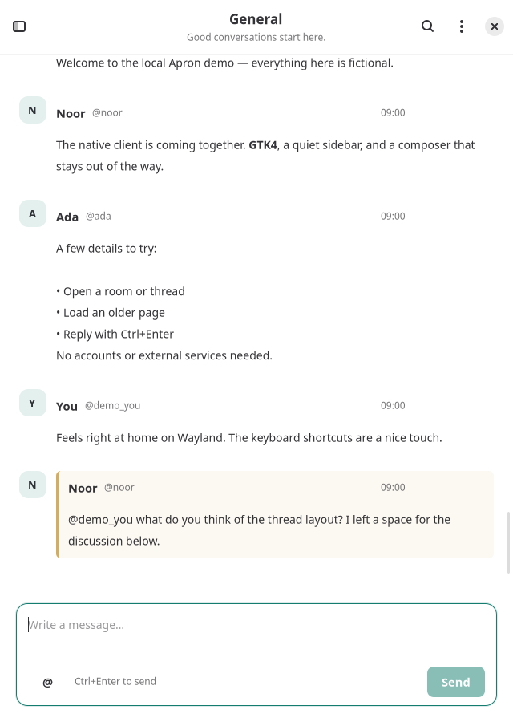

# Native design pass

The conversation is the primary surface. Room navigation, account settings,
and message actions each have one predictable home. The interface uses native
GTK/libadwaita surfaces and focus behavior, with a single restrained teal accent.
This is an implemented design pass over the working client, not a mockup.

## Before and after

| Before | After |
|---|---|
| Permanent account button stack and header toolbar | Sidebar account menu; room title, search and room menu in the header |
| Repeated shaded message cards and action rows | Flat conversation, subtle mention edge, actions disclosed on hover/focus |
| Persistent history controls | Earlier/latest controls appear when relevant, with keyboard shortcuts |
| Mixed dialog spacing and headings | Native titlebar, 24px form inset and consistent trailing action footer |
| Composer visually detached from timeline | Shared content width, short hint, clear native focus treatment |

[Previous desktop](docs/design-before/desktop.png) ·
[Previous compact](docs/design-before/compact.png)

## Visual rules

- Spacing uses 4, 8, 12, 16 and 24px increments. Timeline and composer share
  a 900px content clamp. Sidebar collapses below 760px.
- Room heading 17px, message text 14px, metadata 12px. Native font and
  light/dark surfaces follow system appearance or the explicit preference.
- Teal marks selection, focus and the primary action; amber distinguishes
  explicit mentions. Ordinary message rows have no card background.
- Reply and More keep 36px targets and are visible on hover or focus within
  a message. Right-click, Menu and Shift+F10 expose the same actions. Existing
  reaction chips stay visible; adding one is available in the message menu.
- Account menu contains profile, connection, preferences and shortcuts. Room
  menu contains details/members, thread creation and loaded-cache search.
- Empty/loading views, errors, disconnected state and forms use the same
  typography and spacing. Safety feedback is always visible when relevant.

## Reviewed state gallery

| State | Desktop | Compact |
|---|---|---|
| Dark appearance | [Capture](docs/design/desktop/dark.png) | [Capture](docs/design/compact/dark.png) |
| Focused message actions | [Capture](docs/design/desktop/message-focus.png) | [Capture](docs/design/compact/message-focus.png) |
| Profile | [Capture](docs/design/desktop/profile.png) | [Capture](docs/design/compact/profile.png) |
| Preferences | [Capture](docs/design/desktop/preferences.png) | [Capture](docs/design/compact/preferences.png) |
| Empty room | [Capture](docs/design/desktop/empty.png) | [Capture](docs/design/compact/empty.png) |
| Loading | [Capture](docs/design/desktop/loading.png) | [Capture](docs/design/compact/loading.png) |
| Disconnected, retained draft | [Capture](docs/design/desktop/disconnected.png) | [Capture](docs/design/compact/disconnected.png) |

All images are actual native GTK output under headless Weston with fictional
local data. The regression test also verifies that an incoming snapshot does
not destroy an open message menu. Native daily-action tests cover repeated
submission and stale/interrupted edit guards. See TEST_RESULTS.md for exact
checks and unverified environments. No formal accessibility audit or new
performance benchmark was performed for this design pass.
