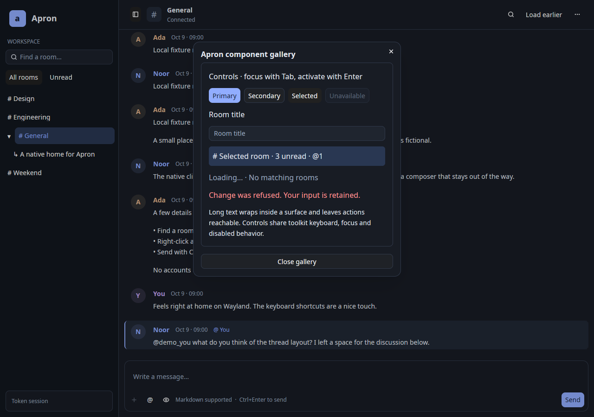
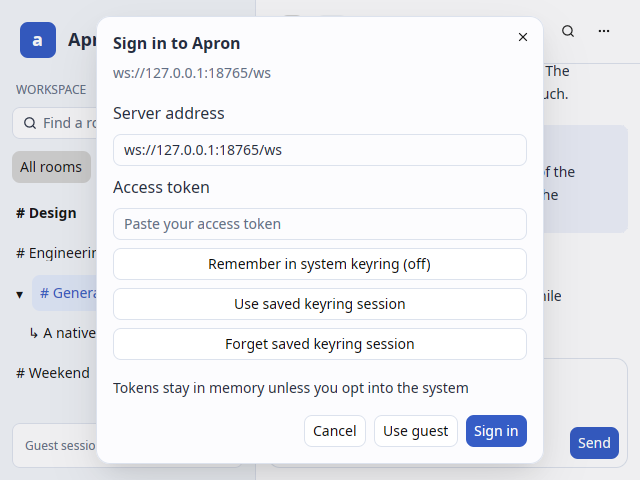

# Design system and daily-use milestone

Starting point: desktop 0caa555; protocol reference in `references/PROTOCOL.md`;
web reference e09522d; Dissent design reference 6ff6182. No Dissent code/assets copied.

## Delivered

- Maintained acceptance checklist and shared GPUI Kit design system. Native component
  gallery available in the conversation menu, including light/dark controls, selected,
  disabled, form, empty/loading and error examples.
- Complete-own-set reaction reconciliation before a write; unknown is not empty.
  A bounded, yielding reconnect replay and optional saved attention metadata recover
  offline messages and previously observed mention edits without replay duplication.
- Compact growing composer, collapsing thread groups with hidden attention, fuzzy
  keyboard conversation switcher and narrow-selection focus restoration.
- Room/thread creation, title/description editing, leave, member list and exact-ID
  membership forms; errors retain input and uncertain writes are not retried.
- Token/server selection, optional Secret Service save/load/clear and rotation,
  separate-connection email proposal/code flow. No plaintext token fallback.
- Expiring typing, basic presence, per-room/inherited mutes; explicit opt-in body-free
  desktop notifications. Explicit safe browser-link action; no automatic media fetching.
- Pinned Nix package/app definitions, desktop entry/icon and CI checks.

## Validation

- 39 core/fixture tests passed, including email connection affinity, unknown reaction
  refusal, multi-page reaction preservation, bounded recovery and saved edit mentions.
  [Log](docs/milestone/tests.log).
- Seven owned local loopback tests passed (official server plus synthetic fixture),
  including room/thread create, rename/leave, two-user private-room add/remove with
  post-removal send denial, history/edit/delete/replies/uploads/reactions. [Log](docs/milestone/loopback.log).
- Cargo release build, formatting and all-target Clippy with warnings denied passed.
  [Clippy log](docs/milestone/clippy.log).
- Native Wayland suites passed at [1280×900](docs/milestone/wide/report.json),
  [800×900](docs/milestone/compact/report.json) and [640×480](docs/milestone/minimum/report.json).
  Gallery, creation form, switcher, menus, light/dark, long text, empty/error and enlarged
  text states were captured and inspected. A clipped sign-in action row was moved into
  the dialog footer, then the minimum-size suite was rerun.
- Official-server native daily workflows passed at [800×900](docs/milestone/daily/report.json)
  and [640×480](docs/milestone/daily-minimum/report.json): editing, reactions, mentions,
  clipboard text/PNG/JPEG, two uploads, explicit image loading and local-state reset.
  Each directory's `run.json` records its exact binary hash. Runs span the documented
  iterative fixes; they are not falsely represented as one identical binary.
- Final source smoke passed at 640×480, including replies, clipboard/selection,
  pagination anchoring, stale-response rejection and uncertain-send handling.
  [Report](docs/milestone/final-smoke/report.json),
  [exact binary hash](docs/milestone/final-smoke/run.json).
- Only synthetic data and isolated owned servers/compositors were used.

## Performance and limits

The final recorded software-renderer benchmark settled to **0 CPU ticks and 0 row
renders over 10 seconds**, at **187.48 MiB RSS**. The earlier refinement recorded
170.48 MiB; this is about 17 MiB higher and is not presented as a speedup. These are
single warm runs, not a statistically controlled comparison or hardware claim.
[Current measurements](docs/milestone/benchmark.json).

An earlier run exposed 29.6% settled single-core CPU with programmatic composer
focus. Removing automatic focus from background/startup selection restored idle
quiescence; explicit user navigation still restores composer focus. Focused text
caret rendering can still incur toolkit redraw work.

Nix is absent here, so the newly added derivation is not locally evaluated/built.
Secret Service, real email delivery, notification daemon, niri, GPU hardware, IME
and assistive software were not validated by the headless fixtures. CI status must
be checked independently. See IMPLEMENTATION.md for bounds and remaining features.

## Screenshots

The compact composer saves vertical space; thread disclosure sits beside its parent,
and the grouped conversation menu avoids a tall flat action list. The fuzzy switcher
shows parent context and caps results so refinement by typing keeps them reachable.

## CI follow-up

Core CI passed for 10963b0. The initial Nix job failed parsing a missing closing
brace in the toolchain hash table. The follow-up closes the table and declares the
compiler target platforms for buildRustPackage; Nix build validation remains pending.
The added two-user membership test passes against the owned official server.
