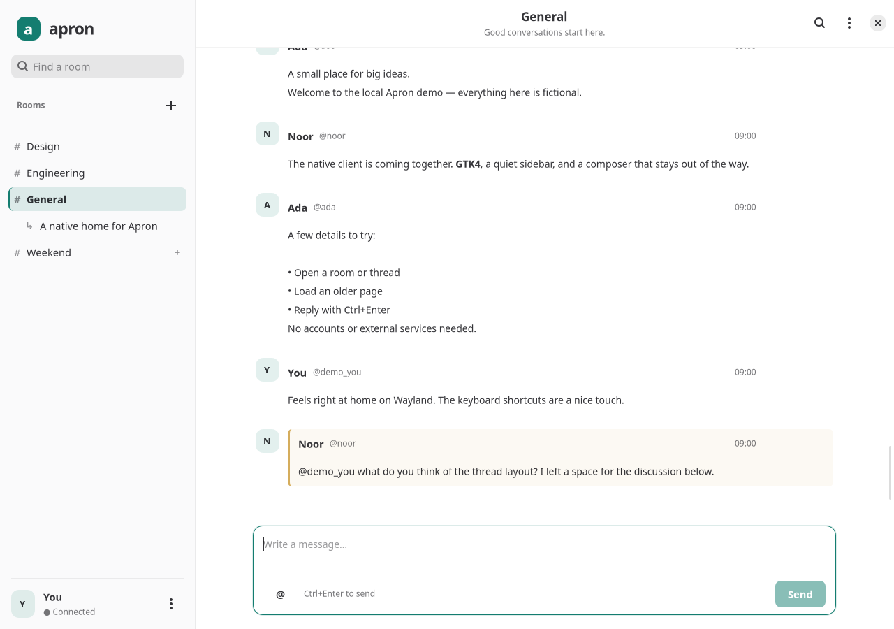

# Apron Native

A working native Linux client for **Apron protocol 8**, built with Python,
GTK4, libadwaita, and libsoup 3. Native Wayland widgets; no Electron, WebView,
HTTP polling, or browser runtime. This is an early vertical slice, not a
complete replacement for apron-web. See [FEATURE_PARITY.md](FEATURE_PARITY.md)
for the source-reviewed functional matrix and remaining work.



## Run on NixOS / niri

The flake pins nixpkgs to an exact revision and supplies the Python interpreter,
GTK4, libadwaita, libsoup, introspection data, desktop launcher, and icon.

```sh
# From an extracted source archive (path: also avoids Git's untracked-file filtering)
nix run path:.                         # connection dialog; no automatic remote connection
nix develop path:.
python scripts/demo_server.py          # terminal 1; fictional loopback-only server
GDK_BACKEND=wayland python -m apron_native.app --demo  # terminal 2, in the dev shell

# Build/install
nix build path:.
nix profile install path:.
```

After installation, launch **Apron** from your application launcher. For niri,
an optional binding is `Mod+A { spawn "apron-native"; }` in the existing `binds`
block. It is an ordinary toplevel Wayland window with app ID `chat.apron.Native`;
it needs no XWayland or compositor-specific plugin. `GDK_BACKEND=wayland` can
force Wayland if troubleshooting backend selection. GTK follows the system's
appearance and scaling settings.

**Nix status:** the exact-revision flake is supplied but was not evaluated or
built here because this environment has no Nix executable. The first Nix run
can generate `flake.lock`; its nixpkgs input is already pinned. niri itself was
not available for testing. Actual native UI verification used Weston/Wayland.

## Run without Nix

Requires Python 3.11+, GTK 4.12+, libadwaita 1.4+, libsoup 3, PyGObject,
markdown-it-py. The demo additionally needs `websockets` (tested at 15.0.1).
On Debian 13:

```sh
sudo apt install python3-gi gir1.2-gtk-4.0 gir1.2-adw-1 gir1.2-soup-3.0 \
  python3-markdown-it python3-websockets
/usr/bin/python3 scripts/demo_server.py
# In another terminal, from this directory:
GDK_BACKEND=wayland /usr/bin/python3 -m apron_native.app --demo
```

Without `--demo`, enter your server's `wss://` address and either a guest
name or an existing bearer token. Guest/token must be offered by that server.
Remote plain `ws://`, URL credentials, and query parameters are rejected.
`ws://` is allowed only for `localhost`, `127.0.0.1`, and `::1` development.
Tokens stay in memory by default. **Preferences → Save session tokens in the
system keyring** is optional and requires libsecret plus an unlocked Secret
Service provider (for example a configured desktop keyring). Use **Use saved
session** in the connection dialog to retrieve one; Forget removes it. There
is no plaintext file fallback. The native keyring adapter is implemented, but
actual service operation was not testable in this environment. Rooms, messages,
drafts and read markers are not written to disk. Connection/name and appearance
preferences can be remembered separately. Do not use a real token for tests.

In the supplied workspace, native dependencies were extracted under `.deps`
because system directories are read-only. This **workspace-only** launcher
uses them; `.deps` is intentionally omitted from source downloads:

```sh
scripts/local-env.sh /usr/bin/python3 scripts/demo_server.py
scripts/local-env.sh /usr/bin/python3 -m apron_native.app --demo
```

## Interface

The conversation has one clear header and composer. Account settings live in
the sidebar account menu; room details, members and thread creation live in the
header room menu. Reply and message actions appear on hover or keyboard focus;
right-click, Menu, or Shift+F10 also opens message actions. Existing reactions
remain visible. History controls appear only when relevant.

See [DESIGN.md](DESIGN.md) for the visual system, before/after captures, and
light, dark, compact, dialog and interrupted-connection previews.

## What works

- Actual asynchronous WebSocket connection with TLS through libsoup, protocol
  greeting, guest or token authentication, in-memory token rotation, response
  correlation, 20-second request timeouts, advertised ping/pong, and randomized
  exponential reconnect backoff (approximately 1–31 seconds).
- Room directory, thread navigation/discovery, joining a listed room, creating
  rooms/private rooms/threads, title/description editing, confirmed leave, member
  listing and exact-ID add/remove, and live room/user/membership updates. No `rooms` capability falls back
  to the default room, learned from messages.
- 50-record history requests, older/latest navigation, numeric inclusive log
  cursors using `first_log_id - 1`, snapshot replacement, moves/tombstones,
  embedded replies, and retention pruning. No history capability means live
  scrollback only.
- Confirmed sends, replies, join-before-send for unjoined rooms, explicit
  member-picker mentions, per-room drafts,
  visible errors, and uncertain-delivery feedback. A disconnected send is
  **never automatically repeated**; check history before sending again.
- In-session unread counts and explicit mention badges; history does not create
  notifications. Read markers advance when the active window is at the bottom
  of the latest page. Own activity cursors from another connection are honored.
- Message **⋯** menus: native clipboard copy, edit/delete/move your messages,
  and start a thread from a message. Edits preserve embeds/mentions/replies/ext;
  stale local editors and changed connections are rejected rather than silently
  overwriting newer state. Pending dialogs guard repeated submissions.
- Reaction counts/toggles and a small native picker; history/live replay per user.
- Profile display-name and advertised status picker. Native light/dark/system
  appearance and opt-in content-free mention notifications through Gio. Real
  desktop notification delivery is still unverified in the headless environment.
- **Find** searches only the bounded loaded-message cache, not all server history.
- CommonMark formatted text through a restricted Pango renderer; raw HTML is
  escaped, images/embeds have text fallbacks, and nothing loads remote media.
  Links are displayed as text and do not execute or open automatically.
- Adaptive sidebar below 760px; selectable message text; native focus behavior.
  `Ctrl+K` finds rooms, `Ctrl+F` searches loaded messages, `Ctrl+L` focuses the
  composer, `Ctrl+Enter` sends, `Alt+Up` opens the parent, `Alt+N` finds the next
  unread room, and `Escape` cancels a reply. `Ctrl+PageUp` loads older history and `Ctrl+PageDown` returns to latest.
  The account menu lists shortcuts. Enter in a room list activates it.

## Bounds and architecture

`model.py` is a GTK-independent state reducer. `session.py` owns libsoup and
request/timer lifecycles on the GLib main context. `app.py` builds native GTK
widgets and coalesces redraws; `ui_actions.py` owns dialogs, `actions.py` preserves
message fields, `preferences.py` persists allowlisted non-secret settings, and
`keyring.py` delegates credentials exclusively to Secret Service. `render.py` converts CommonMark to an allowlisted
Pango subset. No worker polling loop is used.

At most 50 messages are rendered; the shared snapshot cache is capped at
2,000 records **and 8 MiB of serialized message data**, with LRU eviction.
There are at most 256 room records, 2,048 current users, 256 drafts, 64 pending
requests, and 256 KiB per incoming WebSocket frame. Badges cap at 999. GTK and
Python overhead is additional to the serialized cache budget. UI text is
bounded and control/bidi override characters are removed for display.

## Deliberate limitations

- This is not full protocol conformance. Passkeys, email sign-in, durable
  chat/session-cache recovery, multiple accounts, uploads, rich interactive embeds,
  bulk message operations, commands, calls, typing/idle/mutes, and server push are
  deferred. The keyring adapter and Gio notifications require real desktop-service
  validation; they are not yet verified end to end. The public Apron demo may permit
  guest reading but require passkeys for writing; use the local fixture or a
  server that permits guest/token writes for this slice.
- Recovery discards the prior cache after authentication and fetches a fresh
  **latest window** when a room is opened. It does not replay the complete log
  to a durable checkpoint, recover all missed unread/mentions, or persist unread
  state across restarts. Archived pages show available snapshots, not a proven
  complete present-day projection after arbitrary cache eviction. Use Latest
  to refresh. Large-history recovery needs a separate persistent store design.
- Room membership state replays, but timeline membership-event grouping,
  user-ID alias/rename reconciliation, and full live status semantics are incomplete.
  Unread/mention badges cover newly delivered creations, not mention additions
  to edits. Room listings over the 256-room cap are truncated.
- The Markdown renderer preserves common emphasis, headings, lists, code, and
  quotes, but is not a rich document viewer; links and media remain inert text.
- Valid TLS certificates are required; there is no “ignore certificate errors”
  switch. No SSH transport, proxy configuration UI, or background tray mode.

## Measured performance

On the Debian workspace under headless Weston with software rendering, a
1,000-message official-server room (1,045 text bytes/message) showed **78.7 MiB
RSS** after loading 11 pages, and **0.011% of one CPU core** over a 10.05-second
idle sample. The latest benchmark page took 503 ms; ten older pages took
506–599 ms (median 526 ms). Only 50 messages were rendered, with 591 messages
and about 664 KiB of serialized data cached across rooms.

These measurements precede the visual design pass; performance was not
remeasured after it. They are one-run warm-loopback measurements, not hardware-independent targets.
They exclude server/compositor CPU and memory. Idle behavior is encouraging,
but long-message pages still caused a **548 ms worst event-loop interval**:
row virtualization/incremental layout is needed before calling heavy-history
interaction consistently responsive. Avoiding an unnecessary loading-state
rebuild roughly halved page-load time in this synthetic test. See TEST_RESULTS
and the included raw measurements for method and caveats.

## Verification

Start the **local fixture only**, then run:

```sh
python -m unittest discover -s tests -p 'test_*.py' -v
# With a Wayland compositor running and the fixture still running:
GDK_BACKEND=wayland python tests/ui_smoke.py /tmp/apron-preview.png
GDK_BACKEND=wayland python tests/design_smoke.py /tmp/apron-design
```

The fixture binds only `127.0.0.1:18765`, uses fictional people/messages, keeps
state in memory, and is a test harness rather than a deployable server. Its
`/test-denied` and `/test-disconnect` message texts deliberately exercise errors.
Do not expose it to a network or use it with real data.

The official Go reference server was also built and tested separately on
loopback with synthetic data and `--store memory`; connect/list/history/send/
reply/thread/reconnect passed. Reproduce using an isolated official server:

```sh
# Build apron-server-go, then run its binary in a dedicated test directory:
aprond --store memory --addr 127.0.0.1:18766 --messages-per-minute 10000 \
  --upload.dir ./test-uploads
# From this client, in its Python/native development environment:
python tests/reference_interop.py
GDK_BACKEND=wayland python tests/ui_daily_smoke.py /tmp/apron-daily.png
python scripts/seed_reference.py > /tmp/apron-benchmark-seed.json
APRON_BENCH_ROOM=$(python -c 'import json; print(json.load(open("/tmp/apron-benchmark-seed.json"))["room_id"])') \
  GDK_BACKEND=wayland python tests/benchmark_ui.py
```

These scripts hard-code the dedicated loopback test endpoint. `--server
ws://127.0.0.1:18766/ws` also opens it in the client as a guest. Never point
these tests at a server with real content.

See [TEST_RESULTS.md](TEST_RESULTS.md) for actual checks, versions, commands,
and unrun checks. Screenshots show actual GTK rendering under headless Weston,
not an HTML mockup. Source references and pinned commits are in
[references/README.md](references/README.md).

License: MIT; the included protocol reference retains its upstream license.
