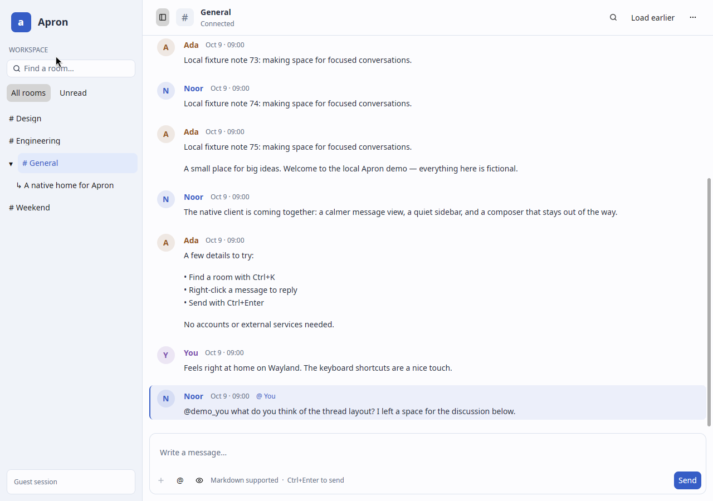

# apron-desktop

This repo is experimenting with desktop-native implementations of an Apron client.

## GPUI native client

A standalone Rust/GPUI Kit client for Apron 8, with a virtualized conversation
view, selectable Markdown, room/thread management, replies, email and token sign-in,
mentions, image/file transfers, contextual editing and opt-in private drafts.
This branch contains only the GPUI implementation. The GTK implementation remains
an independent alternative in [PR #1](https://github.com/apron-chat/apron-desktop/pull/1).
There is no GTK or Python application runtime/build dependency; Python is used
only by optional synthetic test tools. Full apron-web parity remains deferred.



See [IMPLEMENTATION.md](IMPLEMENTATION.md) for the maintained checklist,
[DESIGN_SYSTEM.md](DESIGN_SYSTEM.md) for shared components and interaction rules,
and [DAILY_WORKFLOWS.md](DAILY_WORKFLOWS.md) for current validation. [REFINEMENT.md](REFINEMENT.md)
records the earlier Swiftcord-inspired pass.

## Build and launch on NixOS / niri

From the repository root:

```sh
nix build
nix run . -- --server wss://YOUR_APRON_HOST/ws
# Or develop with the pinned rustup toolchain:
nix develop
cargo build --release --locked
```

Launch inside your existing niri session, with `WAYLAND_DISPLAY` and
`XDG_RUNTIME_DIR` inherited. GPUI uses native Wayland and Vulkan; enable the normal
NixOS graphics driver configuration for your GPU. The app ID is
`chat.apron.GpuiExperiment`. No XWayland or browser is required. For file pickers,
configure your normal `xdg-desktop-portal` backend for niri. Missing portal support
is reported in the UI. Hardware GPU, actual niri, IME, and screen-reader behavior
have not been verified in this workspace.

The flake now exports an installable package and app for x86_64-linux/aarch64-linux,
plus the existing development shell. `nix/package.nix` installs the desktop entry
and icon and wraps runtime libraries, libsecret, xdg-utils and wl-clipboard. `nix/toolchain.nix`
pins official Rust 1.99.0 binary components by checksum because the pinned nixpkgs
compiler is older. Cargo.lock fixes crate versions. The local environment has no Nix executable. GitHub Actions successfully built
the pinned Nix package at baseline `46e19b5`; exact-head validation is recorded in PR #2.
Actual niri/hardware validation remains separate from headless Weston checks.
No compiler patches or RUSTC_BOOTSTRAP are used.

On another Linux distribution supply Rust 1.99, a C/C++ toolchain, pkg-config,
CMake, Clang/libclang, fontconfig/freetype, Wayland, libxkbcommon (including X11),
Vulkan loader and drivers, and X11 development libraries required by GPUI's Linux
build. The `scripts/workspace-env.sh` helper is specific to this workspace's
extracted local dependencies; normal installations should use the commands above.

## Safe local demo

The default address is `ws://127.0.0.1:18765/ws`. From the repository root, run the
fictional fixture in another terminal (Python with `websockets`):

```sh
python3 scripts/demo_server.py
```

Then run `./target/release/apron-gpui` from the repository root. There are no embedded tokens,
accounts, or production messages. The fixture’s documented token
`local-fixture-token` is synthetic and works only with the loopback fixture. Use
`wss` for remote connections; cleartext `ws` is restricted to loopback addresses.
The address can be supplied at launch or changed in the sign-in dialog.

## Implemented scope

- Apron 8 handshake, guest and token auth, room listing/joining, room/thread navigation.
  The conversation menu opens **Sign in with token…**. Tokens and rotated/resume
  tokens stay in RAM by default, with optional system-keyring storage. There is no
  plaintext token file, CLI token argument or automatic guest
  fallback after rejection. The masked field and its undo history are cleared on
  submission. Transport secrets are redacted in Debug and zeroized when dropped;
  UI/network buffers are not promised to be fully zeroized. After restart, sign in again or explicitly load the saved keyring session. Changing sessions explicitly clears drafts and selected files.
- Latest/older history pages of 50. Older pages reconcile edits/deletes/moves against
  a frozen log horizon with a finite 128-page budget. Stale room responses are discarded.
- Shared bounded state (2,000 messages / 8 MiB serialized message data), 2 MiB frame
  limit, virtualized variable-height rows and stable IDs. Caps do not represent
  total process memory: parsed JSON, text layout, renderer and GPU have overhead.
- Markdown text sending, reply references, RAM drafts per room, Ctrl+Enter to send,
  Ctrl+PageUp for older history, Ctrl+PageDown for latest, Escape to cancel a reply, Ctrl+B to toggle navigation.
  The sidebar automatically hides below 900 px until manually toggled; timestamps
  use the local timezone and cached replies include a readable excerpt.
  Connection state stays visible in the header when navigation is hidden.
  Ctrl+K opens a fuzzy room/thread switcher. Threads collapse under their parent with aggregate hidden attention; the list
  filters local room IDs/titles, not remote message history. Live room rename/leave
  deltas update the index. Minimum window is 640×480; cramped panes move history
  controls into the menu and omit the composer hint to preserve the Send action.
- Conversation search: Ctrl+F searches text in the current room's retained messages.
  Enter/F3 and Shift+F3 move between matches; Escape from the search field closes it.
  Results are cached between data/query changes. The count explicitly says “loaded
  only”; paginate manually to extend the search. It never searches a remote archive.
- Reactions, when advertised: the contextual React submenu offers Like, Love,
  Celebrate and Laugh. Existing reaction chips show totals and toggle your set.
  Before each toggle, a forward scan of at most 32 × 50 log changes establishes
  the complete own set. Unknown/expired/oversized/budget-exceeded state refuses the
  write instead of replacing from a partial cache. Empty sets remove reactions. No optimistic counts or automatic retries after uncertain completion.
  Limits: 2,048 message/user sets, 16 emoji per set, 64 bytes per emoji; oversized
  sets are ignored. Counts and your set cover retained/fetched evidence; unseen or
  evicted older reactions may be absent. A complete historical reaction census remains deferred. The Choose emoji action searches the
  Unicode catalogue by name/shortcode or pasted emoji, including skin variants;
  it uses the same conservative reaction reconciliation.
- The sidebar's Unread view filters received/fetched unread rooms. A semantic blue
  selection, nested threads, deterministic local author initials, and compact
  same-author runs improve scanning. Initials require no avatar downloads.
  Conversation menu → Switch light / dark saves the appearance for this server/user profile.
- Contextual message actions: right-click, or Tab to a row’s ellipsis and press
  Enter. Reply/Copy labels no longer repeat on every row. Menus support arrows,
  Enter and Escape. With message actions focused, R replies and Ctrl+Shift+C
  copies the whole message. The conversation menu includes keyboard help.
- Session-local unread/mention counts (up to 2,000 pending messages across 256
  rooms), using server mention IDs, not text matching. Only a focused window at
  the conversation tail automatically marks messages read. Reading earlier history
  preserves unread state. Ctrl+Shift+U marks the room read; the unread header action
  jumps to the first retained unread message. Read activity is best-effort and only
  sent when supported. Own activity broadcasts advance local cursors.
  Saved cursors reconcile fetched history on reconnect/room entry. A fresh profile
  starts at its first fetched page. Counts cover received/fetched evidence, not all
  unfetched offline rooms; bounds can discard the oldest pending entries.
- Selectable rendered Markdown, Ctrl+C selection and explicit whole-message Copy.
  Headings, emphasis, lists, quotes and code render natively. Raw HTML and Markdown
  images are removed and links are inert; no automatic media requests. Outgoing
  text uses Markdown; Preview shows the sanitized result before sending.
- Type @ and select a supplied room member using arrows/Enter or a click. The
  Notifies chips show explicit protocol recipients; typing a display name alone
  never guesses a recipient. Completion supports up to 512 supplied members, six
  matches, 32 selected recipients, and whitespace-free IDs up to 128 bytes.
  Incoming protocol mentions have a textual @ You label and a next-unread-mention action.
- Own messages expose Edit/Delete when the server advertises edit. Edits retain
  body metadata, embeds and the reply reference. Delete requires a dialog action.
  Stale cached targets are rejected; server permission errors preserve the editor.
  Uncertain changes are never retried automatically.
- One to four chosen regular files, at most 8 MiB total; explicit same-origin
  upload/download, no redirects or auth forwarding. Downloads use a private
  temporary file and refuse to overwrite an existing destination. A local commit
  already begun can finish after cancellation. Transfers run independently of
  WebSocket heartbeats. Ctrl+V/Shift+Insert accepts native PNG/JPEG/WebP/GIF/BMP
  images, normalizes them to PNG in a worker, and shows removable previews. Paste
  never sends. Embedded upload images require an explicit same-server Load action.
  Raster limits: 4096 pixels per side, eight million pixels, 64 MiB decoder budget;
  eight cached thumbnails, each at most 640×480. SVG is rejected; animation uses
  its first frame. Metadata is removed during normalization. Drop local files onto the composer or
  paste a file-manager copy to stage files, then explicitly Send. File clipboard
  offers use `wl-paste` (included by Nix); ordinary text is never treated as a path.
  Rename staged attachment titles before sending, or edit your sent message
  to change attachment titles independently of its caption. Local filenames and
  attachment identity/URLs are preserved. Titles are 1–180 characters.
- Bounded event channels, protocol heartbeat, exponential reconnect, explicit errors.
  Uncertain sends are not automatically retried. Reconnect uses the latest returned
  session token, including guest tokens, preserving identity where supported.
  Authentication rejection waits for explicit action; a network loss during auth
  reconnects with a generic error that cannot echo token input.

**Current daily-use additions:** conversation menu → Room and members creates rooms
and threads, edits title/description, lists members, adds/removes exact user IDs,
and leaves rooms. Server permissions remain authoritative; unsupported membership
changes show errors. Preferences saves desktop notification opt-in, theme and typing/idle privacy, with
per-room mute/unmute and online/opt-out presence. Advertised DND/invisible states
are offered; opt-in idle reports inactive focus or five minutes without app input. Notifications contain no chat text,
respect focused rooms, inherited mutes and DND, and are rate limited. Typing expires
using one-shot timers; outgoing typing is throttled, not polled.

**Login:** token sign-in optionally saves rotated credentials through Secret Service
using `secret-tool` (libsecret). No credentials enter command arguments or plaintext
profile files. The form can load or remove the saved session for the exact server
URL. One account is remembered per URL. A missing/locked service fails visibly;
this environment tested the unavailable path, not a real keyring round trip.
Email sign-in uses a separate unauthenticated WebSocket for proposal and code
approval; provider errors are redacted. Account creation depends on server policy.

**Links:** message menu → Open external links lists up to 16 explicit HTTP(S)
links for browser opening. Credential-bearing and active/local schemes are rejected.
No previews or images are fetched automatically.

**Remaining:** native passkeys, complete archive reaction counts, remote search,
avatars, richer media viewing and broader server-specific moderation commands.
See [the integration assessment](INTEGRATION_ASSESSMENT.md) for concrete next steps. The protocol defines no generic
remote search or room-list pagination cursor; no endpoints are invented. Room lists
remain capped at 256. Full web parity is not claimed.

The transport owns its own Tokio runtime; GPUI awaits events without busy polling.
CPU timers in `--smoke` and `--benchmark` exist only in opt-in test modes.

## Local data and privacy

Conversation menu → **Preferences and local data** enables draft/read-cursor persistence for the
current server/user. It is off by default. It stores draft text, reply IDs, selected
mention IDs, read cursors and bounded attention metadata (message/log IDs and mention
flags); never tokens, message bodies or attachments. Files
are unencrypted, private (0600, directory 0700), atomic, and keyed by a hash of the
server/user. Location: `$XDG_STATE_HOME/apron-gpui` (default `~/.local/state/apron-gpui`).
Limits: 256 rooms, 32,000 bytes per draft, 256 KiB draft text, 512 KiB per profile,
16 profiles. Errors are visible; drafts over limits are not silently truncated.
Appearance/notification/privacy choices use the same bounded versioned file but
do not enable draft storage. Disable draft storage erases saved draft/read metadata
while retaining preferences and current drafts; Reset removes preferences and also clears
this session's drafts and selected files. Debounced writes and reset share an
ordered worker. Normal exit flushes; an abrupt kill can lose the latest changes.
Concurrent app instances for the same profile are not coordinated (last writer
wins). Guest identity survives reconnect in memory; after a full restart, sign in
as the same user to recover that profile. No plaintext bearer token is persisted.

GPUI's upstream Wayland clipboard reader buffers an offered clipboard payload
before returning it to the application. The app enforces its byte/pixel limits
after that read; this is **not a pre-read memory bound** against a malicious local
clipboard owner. HTTP transfers and raster decoding have separate explicit bounds.
Image upload creates the message before transferring bytes. On failure/cancel,
inspect the posted message before retrying; the app does not automatically repost.
Clipboard previews are session-only and clear when switching rooms.

See [DAILY_WORKFLOWS.md](DAILY_WORKFLOWS.md) for current validation and visual review;
[MILESTONE.md](MILESTONE.md) documents the preceding milestone;
[DAILY_USE.md](DAILY_USE.md) retains the earlier daily-use implementation evidence.

## Verification

All commands run from the repository root. Python scripts here are optional test
fixtures, not application modules. To run the eight integration tests, build the
[official Apron server](https://github.com/shazow/apron) separately, then use:

```sh
python3 scripts/run-loopback-tests.py --aprond /absolute/path/to/aprond
```

The runner refuses occupied test ports, starts its own in-memory server on 18766
and fictional fixture on 18765, and cleans up only its own child processes. It
uses temporary upload data. No GTK checkout or helper is required.
`python3 scripts/seed_reference.py` separately seeds only port 18766 for the native
benchmark; its output supplies the synthetic room ID.


```sh
cargo test --locked --no-default-features
cargo build --release --locked
# With only the dedicated synthetic fixture (18765) and official server (18766):
cargo test --locked --no-default-features --test loopback -- --ignored --nocapture
# Inside an isolated native Wayland test session:
./target/release/apron-gpui --smoke /tmp/gpui-smoke.json
./target/release/apron-gpui --polish-smoke /tmp/gpui-polish.json
XDG_STATE_HOME=/tmp/apron-native-test-state ./target/release/apron-gpui \
  --server ws://127.0.0.1:18766/ws --daily-smoke /tmp/gpui-daily.json
./target/release/apron-gpui --server ws://127.0.0.1:18766/ws \
  --benchmark SYNTHETIC_ROOM_ID /tmp/gpui-benchmark.json
```

`--smoke` refuses non-fixture addresses. Integration tests use literal loopback
ports and create only synthetic content. The benchmark is restricted to the official loopback server on 18766 and reads
an explicitly provided room; use only synthetic benchmark rooms. Set
`APRON_BENCH_RENDERER` to a verified renderer description when collecting results;
the harness does not detect the Vulkan device itself. Test logs and measured data
are included in `docs/`.

Headless Weston needs a `wl_seat` for GPUI. `scripts/weston-test-seat.c` is an
optional test-only module against **Weston 14** exported internal APIs, not part
of the application or a module to install into your desktop. Build it with
`cc -shared -fPIC $(pkg-config --cflags libweston-14) scripts/weston-test-seat.c -o
/tmp/apron-test-seat.so $(pkg-config --libs libweston-14)` and load it only into
an isolated headless Weston with `--modules=/tmp/apron-test-seat.so`. For the
inter-process clipboard smoke, start that test compositor with
`APRON_TEST_SEAT_INPUT=1` and the app with `APRON_VERIFY_CLIPBOARD=1`; install
`wl-clipboard`. The module issues one harmless modifier press/release after focus
and then stops. Do not enable it for benchmarks. See the
comparison report for the actual renderer and test method.

## References

- [Apron protocol](https://github.com/shazow/apron/blob/main/PROTOCOL.md)
- [apron-web](https://github.com/apron-chat/apron-web), reference checkout `fbb3e71a3483544a4bdf7236070cf48e87686377`
- Official Go reference checkout `067083815be6b113e7d35f6569fa35dee0052fd5`
- [GPUI](https://gpui.rs/) and [GPUI Kit 0.7.1](https://gpui-kit.com/docs/installation/)
- [MessageScroller](https://gpui-kit.com/component/message-scroller/),
  [TextView](https://gpui-kit.com/component/text-view/), and
  [Textarea](https://gpui-kit.com/component/textarea/) APIs were checked against
  the actual downloaded source; repository GPUI Kit skills/guides were followed.

## Design and feature review

See [DESIGN_REVIEW.md](DESIGN_REVIEW.md) for the screenshot critique, changes and
actual native checks, and [FEATURE_PARITY.md](FEATURE_PARITY.md) for implemented
versus deferred product scope. The GPUI draft PR targets main independently of the GTK alternative. Existing
history is preserved, but the current tree and source archive contain no GTK client.
See [STANDALONE.md](STANDALONE.md) for the original layout migration and
[REFINEMENT.md](REFINEMENT.md) for the current design, features and verification.
