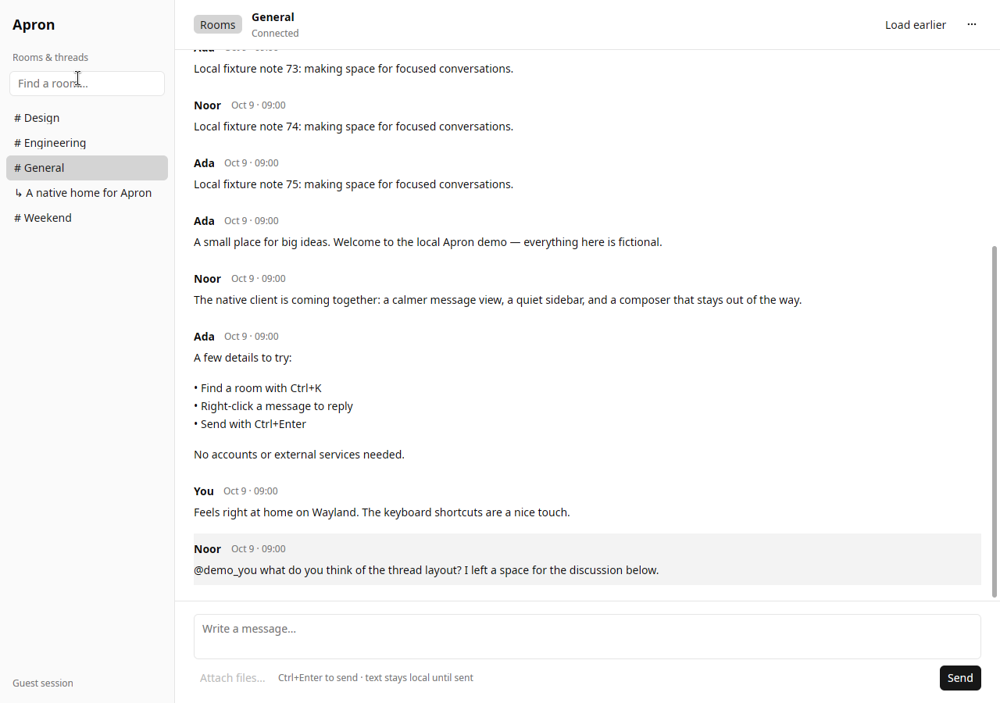

# Apron GPUI comparison

A separate, local Rust/GPUI Kit experiment alongside the GTK client. This is a
working protocol client, with a virtualized variable-height transcript, selectable
Markdown, contextual reply/copy actions, session token sign-in, unread/mention
badges, room filtering, and bounded explicit file transfers. It is **not yet a replacement
for the GTK client**. See [COMPARISON.md](COMPARISON.md) for measured results and gaps.



## Build and launch on NixOS / niri

From this `gpui/` directory:

```sh
nix develop
cargo build --release --locked
./target/release/apron-gpui --server wss://YOUR_APRON_HOST/ws
```

Launch inside your existing niri session, with `WAYLAND_DISPLAY` and
`XDG_RUNTIME_DIR` inherited. GPUI uses native Wayland and Vulkan; enable the normal
NixOS graphics driver configuration for your GPU. The app ID is
`chat.apron.GpuiExperiment`. No XWayland or browser is required. For file pickers,
configure your normal `xdg-desktop-portal` backend for niri. Missing portal support
is reported in the UI. Hardware GPU, actual niri, IME, and screen-reader behavior
have not been verified in this workspace.

The flake pins nixpkgs and evaluates on x86_64-linux and aarch64-linux. It is a
**development shell**, not a fully built Nix package. Cargo.lock and
rust-toolchain.toml pin dependencies and Rust 1.99.0; rustup downloads that
compiler on first use. The shell includes Python with websockets for the synthetic fixture. GPUI Kit 0.7.1 depends on gpui-pre 0.3.8. Rust 1.94 was
insufficient for this dependency snapshot (`std::hint::cold_path`). No patches or
RUSTC_BOOTSTRAP are used. A clean Nix build and aarch64 compilation remain unrun.

On another Linux distribution supply Rust 1.99, a C/C++ toolchain, pkg-config,
CMake, Clang/libclang, fontconfig/freetype, Wayland, libxkbcommon (including X11),
Vulkan loader and drivers, and X11 development libraries required by GPUI's Linux
build. The `scripts/workspace-env.sh` helper is specific to this workspace's
extracted local dependencies; normal installations should use the commands above.

## Safe local demo

The default address is `ws://127.0.0.1:18765/ws`. From this `gpui/` directory, run the
fictional fixture in another terminal (Python with `websockets`):

```sh
python3 scripts/demo_server.py
```

Then run `./target/release/apron-gpui` from `gpui/`. There are no embedded tokens,
accounts, or production messages. The fixture’s documented token
`local-fixture-token` is synthetic and works only with the loopback fixture. Use
`wss` for remote connections; cleartext `ws` is restricted to loopback addresses.
The address is supplied at launch, not through an in-app settings dialog.

## Implemented scope

- Apron 8 handshake, guest and token auth, room listing/joining, room/thread navigation.
  The conversation menu opens **Sign in with token…**. Tokens and rotated/resume
  tokens stay in RAM; there is no token file, CLI token argument or automatic guest
  fallback after rejection. The masked field and its undo history are cleared on
  submission. Transport secrets are redacted in Debug and zeroized when dropped;
  UI/network buffers are not promised to be fully zeroized. Restarting requires
  signing in again. Changing sessions explicitly clears drafts and selected files.
- Latest/older history pages of 50. Older pages reconcile edits/deletes/moves against
  a frozen log horizon with a finite 128-page budget. Stale room responses are discarded.
- Shared bounded state (2,000 messages / 8 MiB serialized message data), 2 MiB frame
  limit, virtualized variable-height rows and stable IDs. Caps do not represent
  total process memory: parsed JSON, text layout, renderer and GPU have overhead.
- Plain-text sending, reply references, RAM drafts per room, Ctrl+Enter to send,
  Ctrl+PageUp for older history, Ctrl+PageDown for latest, Escape to cancel a reply, Ctrl+B to toggle navigation.
  The sidebar automatically hides below 900 px until manually toggled; timestamps
  use the local timezone and cached replies include a readable excerpt.
  Connection state stays visible in the header when navigation is hidden.
  Ctrl+K opens/focuses room filtering. Threads sort beside their parent; the list
  filters local room IDs/titles, not remote message history. Live room rename/leave
  deltas update the index. Minimum window is 640×480; cramped panes move history
  controls into the menu and omit the composer hint to preserve the Send action.
- Contextual message actions: right-click, or Tab to a row’s ellipsis and press
  Enter. Reply/Copy labels no longer repeat on every row. Menus support arrows,
  Enter and Escape. With message actions focused, R replies and Ctrl+Shift+C
  copies the whole message. The conversation menu includes keyboard help.
- Session-local unread/mention counts (up to 2,000 pending messages across 256
  rooms), using server mention IDs, not text matching. Only a focused window at
  the conversation tail automatically marks messages read. Reading earlier history
  preserves unread state. Ctrl+Shift+U marks the room read; the unread header action
  jumps to the first retained unread message. Read activity is best-effort and only
  sent when supported. Own activity broadcasts advance local cursors.
  Counts cover received session events: there is no startup/backfill unread count
  or offline notification recovery. Bounds can discard the oldest pending entries.
- Selectable rendered Markdown, Ctrl+C selection and explicit whole-message Copy.
  Raw HTML/images are removed and links are inert; no automatic media requests.
- One to four chosen regular files, at most 8 MiB total; explicit same-origin
  upload/download, no redirects or auth forwarding. Downloads use a private
  temporary file and refuse to overwrite an existing destination. A local commit
  already begun can finish after cancellation. Transfers run independently of
  WebSocket heartbeats. Attachment thumbnails, drag/drop and clipboard paste are deferred.
- Bounded event channels, protocol heartbeat, exponential reconnect, explicit errors.
  Uncertain sends are not automatically retried. Reconnect uses the latest returned
  session token, including guest tokens, preserving identity where supported.
  Authentication rejection waits for explicit action; a network loss during auth
  reconnects with a generic error that cannot echo token input.

**Deferred:** email/OAuth/account creation, persistent state, durable unread recovery,
notifications, room creation/moderation, edit/delete UI, presence/typing, settings,
remote message search, rich compose, active external links, attachment previews, durable drafts,
full apron-web feature parity. GTK retains the broader product implementation.
Room lists and draft count are capped at 256; room-list pagination is not implemented.

The transport owns its own Tokio runtime; GPUI awaits events without busy polling.
CPU timers in `--smoke` and `--benchmark` exist only in opt-in test modes.

## Verification

```sh
cargo test --locked --no-default-features
cargo build --release --locked
# With only the dedicated synthetic fixture (18765) and official server (18766):
cargo test --locked --no-default-features --test loopback -- --ignored --nocapture
# Inside an isolated native Wayland test session:
./target/release/apron-gpui --smoke /tmp/gpui-smoke.json
./target/release/apron-gpui --polish-smoke /tmp/gpui-polish.json
./target/release/apron-gpui --server ws://127.0.0.1:18766/ws \
  --benchmark SYNTHETIC_ROOM_ID /tmp/gpui-benchmark.json
```

`--smoke` refuses non-fixture addresses. Integration tests use literal loopback
ports and create only synthetic content. The benchmark is restricted to the official loopback server on 18766 and reads
an explicitly provided room; use only synthetic benchmark rooms. Set
`APRON_BENCH_RENDERER` to a verified renderer description when collecting results;
the harness does not detect the Vulkan device itself. Test logs and measured data
are included in `docs/`.

Headless Weston needs a `wl_seat` for GPUI. `scripts/weston-test-seat.c` is an
optional test-only module against **Weston 14** exported internal APIs, not part
of the application or a module to install into your desktop. Build it with
`cc -shared -fPIC $(pkg-config --cflags libweston-14) scripts/weston-test-seat.c -o
/tmp/apron-test-seat.so $(pkg-config --libs libweston-14)` and load it only into
an isolated headless Weston with `--modules=/tmp/apron-test-seat.so`. For the
inter-process clipboard smoke, start that test compositor with
`APRON_TEST_SEAT_INPUT=1` and the app with `APRON_VERIFY_CLIPBOARD=1`; install
`wl-clipboard`. The module issues one harmless modifier press/release after focus
and then stops. Do not enable it for benchmarks. See the
comparison report for the actual renderer and test method.

## References

- [Apron protocol](https://github.com/shazow/apron/blob/main/PROTOCOL.md)
- [apron-web](https://github.com/apron-chat/apron-web), reference checkout `fbb3e71a3483544a4bdf7236070cf48e87686377`
- Official Go reference checkout `067083815be6b113e7d35f6569fa35dee0052fd5`
- [GPUI](https://gpui.rs/) and [GPUI Kit 0.7.1](https://gpui-kit.com/docs/installation/)
- [MessageScroller](https://gpui-kit.com/component/message-scroller/),
  [TextView](https://gpui-kit.com/component/text-view/), and
  [Textarea](https://gpui-kit.com/component/textarea/) APIs were checked against
  the actual downloaded source; repository GPUI Kit skills/guides were followed.

## Design and feature review

See [DESIGN_REVIEW.md](DESIGN_REVIEW.md) for the screenshot critique, changes and
actual native checks, and [FEATURE_PARITY.md](FEATURE_PARITY.md) for implemented
versus deferred product scope. This experiment remains separate from the GTK
worktree and its draft PR. No GPUI push, PR, publication or deployment was performed.
